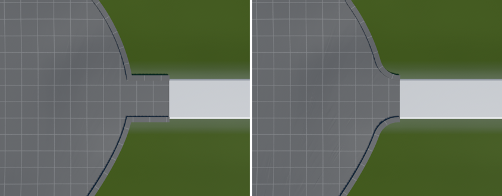

A **Spline Paving** paves where roads meet. Put it on a closed spline that is an area, and the whole area is paved, with the first stretch of every road that enters it. Put it on a road, and every place where another road crosses it or ends on it is paved. Where the roads go on, the paving stops square across them and the road's own surface takes over at the same height. Where a road turns close to the paving, the paving follows it around the turn and stops on the straight road after it. Every other edge of the paving gets a curb.

## Pave a square

:::steps

1. Draw a closed spline for the square. Add the **Spline Network Member** component to it and set its **Kind** to **Area**.
2. Draw the roads. Give each road a **Spline Network Member** with **Kind** set to **Road**, and a **Spline Extrude** for its surface.
3. Drag the end of each road into the square, or draw the road across it. A road joins the square where its centerline crosses the outline or ends on it.
4. Select the square and add the **Spline Paving** component. The square and the start of each road are paved in flat gray, with a 0.3 m curb along every edge where no road continues.
5. Under **Surface**, assign a **Material** to give the paving its stone. Under **Curb**, assign a **Material** for the curb if it differs.

:::

:::tip[A square with no road is paved whole]
A square that no road enters is paved inside its outline, with a curb all the way around. It reports nothing.
:::

## Where roads meet

The paving reads the junctions of the spline network. A junction exists where two network splines touch: a road that crosses the square's outline or ends on it, a road that crosses another road, or a road that ends on the side of another road. A road whose end stops short of the outline, by any distance, makes no junction and is not paved into the square.

The Scene View marks every junction with a ring: white where the splines join, amber where their heights differ, and teal for a moment after a junction forms. Point at a ring, with any tool, to read the junction's kind, the two splines and its state, for example "Entry · Mill Lane into Market Square · 0.41 m below the paving". When you drag a road's end knot, or draw a road, near a square's outline or another road's side, the end snaps onto it: a teal ring shows where the end lands and the hover text says "Snap to" and the spline's name. The snap reaches about one knot width on the screen at every zoom. Turn it off with **Snap Ends to Nearby Splines** in the spline tool's menu.

The **Junctions** section of the inspector lists each junction of the spline: the other spline and where they meet (entry, crossing, or T junction) on the left, and its state on the right.

| State | What it means |
|---|---|
| paved | This paving paves the junction. |
| paved by *name* | Another Spline Paving builds the surface there. Two that reach one junction pave it once. |
| *d* m above the paving, *d* m below the paving | The road and the spline are at different heights where they meet, so the junction is not paved. See [Heights that differ](#heights-that-differ). |
| not paved: own surface | The road is switched off under **Splines It Touches** and keeps its own surface. |
| not paved: cut out | The closed road is switched off and set to **Cut out** under **Splines It Touches**. |
| not paved: too narrow | The road has no width where it meets the spline. |

Where two Spline Paving components overlap, one of them builds the surface: the area that holds the overlap, else the one on the longer spline. The others read **paved by** with its name.

## The mouth

Where a road enters an area, **Shape** under **Road Mouths** sets the shape of the paving's edge at the road.

| Shape | What it builds |
|---|---|
| Flared | The edge of the area turns into each side of the road on an arc of **Radius**, and the curb follows the arc. The road's surface starts where the arcs end. |
| Straight | The sides of the road meet the edge of the area at a sharp corner. |

An arc that does not fit is made smaller. Where two roads enter less than two radii apart, their arcs meet halfway between the roads. A road that enters along the edge gets no arc. A road that enters at a shallow angle gets a smaller arc on its sharp side, so the arc ends at most three road widths, or one radius if that is more, past the corner. The setting applies to every road that enters the area. A Spline Paving on a road (the one that paves the road's junctions) gets no mouth: only an area has an edge to flare. The paving's material stops on a straight line across the road, where the road's own surface starts.

## Splines It Touches

The **Splines It Touches** section lists every closed spline that overlaps the paving and every road that meets it, by name. A row's switch is on when the paving covers that spline, and the words beside the switch say what happens. Switch a row off to leave the spline out:

| Spline | When it is off | What it does |
|---|---|---|
| A closed spline that is not a road, such as a planting bed | cut out | Its area is cut out of the paving, and the curb runs around it. |
| A road | its own surface where it meets | The road keeps its own surface through the paving. On an area, the paving is cut back along the road, and the curb runs beside it. On a road, the paving stops at both edges of the left-out road and meets it flush: the curb runs only along the sides of the paving road. |
| A closed road, such as a ring road | cut out, or its own surface where it meets | Choose with the two buttons, **Cut out** and **Own surface**, that show when the switch is off. **Cut out** cuts out the area inside the road and the road's surface, and the curb runs around both. |

Each change is one undo step: **Leave Out of Paving**, **Pave Again**, or **Switch Paving Mode**. A left-out spline that you delete stays in the list as a dim row until you switch it on, and undo restores it.

## Heights that differ

A paved area whose **Ground Authority** grades the ground (**Owns** or **Grades**) paves every road that enters it, at any height: the ground meets each road at the road's height. Everywhere else, on a road's paving and on an area set to **None**, a road joins only where its height is within 0.25 m of the spline it meets. Where the heights differ by more, the junction is not paved, the inspector header shows a badge such as **1 road not paved**, and a notice names the road and the two fixes:

> "Mill Lane" is not paved into "Market Square". Its end is 0.41 m below "Market Square", and a road joins only within 0.25 m. Raise or lower the road's last point, or choose Join at Grade to pave "Mill Lane" into "Market Square" at the height of "Market Square".

Until the heights match, the paving is cut back along the road, and the curb runs beside it, so the road keeps its own height. The same text goes to the Console. **Join at Grade** on the junction's row paves the road into the spline at the spline's height. It is one undo step named after the road.

## A road's verge

A road can carry a curb of its own, the verge. Select the road, and in its **Spline Extrude**, under **Verge**, turn on **Build Verge**. The road gets a curb along both edges of its surface. The verge has the cross-section of the paving's curb: it is **Width** wide out from the edge of the road and stands **Height** above the road's surface.

When you turn on **Build Verge** on a road that a Spline Paving paves, an empty verge **Material** takes that paving's curb material, so the curb and the verge show one surface. The field stays editable. A road that two pavings pave takes the material of the first paving along the road, from the road's start. A junction that reads **paved by** another paving gives no material.

Where a road with a verge leaves a paving, the paving's curb runs on into the verge with no end face. With a **Flared** mouth, the curb changes to the verge's width and height along the arc. With a **Straight** mouth, the curb turns square at the corner whatever **Corner** sets, and changes to the verge's size over its last curb width before the road, so a change of size shows as a short step. Where a road has no verge, the curb ends square where the road's surface starts.

| Setting | Default | What it does |
|---|---|---|
| Build Verge | Off | Builds a curb along both edges of the road. |
| Width (m) | 0.3 m | How wide the verge is, out from each edge of the road. The slider runs to 1 m; a typed value can be from 0.01 m to 10 m. Inactive while **Build Verge** is off. |
| Height (m) | 0.12 m | How high the verge stands above the road's surface. The slider runs to 1 m; a typed value can be from 0.01 m to 10 m. Inactive while **Build Verge** is off. |
| Material | Empty (uses the road's Material) | The surface drawn on the verge. Turning on **Build Verge** on a road that a Spline Paving paves fills it with the paving's curb material. Inactive while **Build Verge** is off. |

The defaults match the paving's curb, so the curb runs into the verge at one size. A road that fills to its banks (**Fit To Banks**) has no verge. Scripts and scene files use the field names `Verge`, `VergeWidth`, `VergeHeight` and `VergeMaterial`.

## Settings

The inspector shows its sections in this order: **Surface**, **Curb**, **Road Mouths**, **Placement**, **Splines It Touches**, **Junctions** and **Shadows**. **Corner**, **Shape** and **Conform Target** show a picture of each choice. **Width**, **Height** and **Radius** are sliders with a number box; a typed value outside the slider's range is set to the nearest end, except for the curb's **Width** and **Height**, whose sliders run to 1 m and whose typed values can be up to 10 m.

| Section | Setting | Default | What it does |
|---|---|---|---|
| Surface | Material | Empty (flat gray) | The surface drawn on the paving. Texture coordinates are in meters on the ground, so the stone size is the material's own tiling. |
| Surface | Seed | 0 | Offsets the paving pattern on the ground. Any whole number gives another placement of the pattern; the outline and the curb stay as they are. Change it when two Spline Paving components with one material look alike. |
| Curb | Width (m) | 0.3 m | How wide the curb is, from 0 m to 10 m. 0 builds no curb. |
| Curb | Height (m) | 0.12 m | How high the curb stands above the paving, from 0.01 m to 10 m. |
| Curb | Corner | Miter | How the curb turns where the edge turns. **Miter** turns on one sharp edge. **Round** sweeps the outside in an arc. |
| Curb | Material | Empty (uses the Surface material) | The surface drawn on the curb. |
| Road Mouths | Shape | Flared | How the paving meets a road that enters it. See [The mouth](#the-mouth). |
| Road Mouths | Radius (m) | 1.5 m | The radius of the arc at each side of a **Flared** mouth, from 0.1 m to 10 m. Inactive with a **Straight** mouth. |
| Placement | Ground Authority | Auto (Owns) | What a paving on a closed spline does to the terrain under it. **Owns** grades and claims the ground, clears the grass and paints the ground. **Grades** grades the ground and does not claim it. **None** leaves the terrain as it is; the paving lies on the ground as the roads graded it. See [The ground](#the-ground). A paving on a road has no Ground Authority: the road's own Ground Authority shapes that ground. |
| Placement | Conform Target | Terrain Only | What the paving lies on. **Terrain Only** lays it on the terrain, so props on the square never lift it. **Scene** lays it on any surface, such as a bridge deck. |
| Shadows | Cast Shadows, Receive Shadows | On | Shadowing, as on any mesh. |

Scripts and scene files use the field names: `Material`, `Seed`, `BorderWidth`, `BorderHeight`, `BorderCorner`, `BorderMaterial`, `Mouth`, `MouthRadius`, `GroundAuthority`, `ConformTarget`, `CastShadows` and `ReceiveShadows`.

Edits rebuild the paving a quarter of a second after you stop dragging. A change of material or shadows changes the paving in place with no rebuild.

## The ground

On a closed spline, **Ground Authority** sets what the paving does to the terrain under it. **Auto** is **Owns**, as for a road:

- The terrain inside the rim is graded to a smooth surface through the heights of the rim, so a paving on a slope follows the slope. Where a road crosses the rim, the surface meets the road at the road's own height across the road's full width. Past the rim the ground fades back to the ground around it over 3 m.
- The paving claims that ground, so a path that grades the terrain stops at the paving's edge. A road that owns its ground and enters the paving averages its grade with the paving's where the two overlap.
- The grass under the paving is cleared, and the ground is painted with the terrain's Dirt layer, which shows in the fade past the rim. The paving owns its approaches: the ground under each road from the paving's edge to where the road's own surface starts is cleared and painted too. Under a road whose Ground Authority is **None**, the paving also grades and claims that ground. A road on **Grades** keeps its own grade there, and a road that owns its ground clears its own approach.

The effects go on the paving's own entity as a Spline Area volume, a Flatten, a Ground Claim, a Grass effect and a Paint Layer effect. You can tune their fields. Each approach gets a generated entity under the paving with a Spline Path volume that takes the Falloff, Weight and Priority of the paving's volume, and copies of the paving's Grass and Paint Layer effects (and of its Flatten and Ground Claim under a road on **None**). A change to the paving's volume or effects reaches its approaches. A change of Ground Authority removes only the effects that it added, and one undo reverts the change and its effects.

Two limits apply. Beds are graded and painted too: a bed that the paving cuts out is still graded, painted and cleared of grass. The note under **Ground Authority** in the inspector states this. Under a road on **Grades**, the approach ends about one road width past the paving's edge, and past that point the grass grows up to the road's edge.

A paving on a road lies on the terrain as it is and does not reshape it. The road's own Ground Authority shapes that ground. A road that owns its ground clears the grass under it and paints it with the Dirt layer; under a road that only grades the ground, the grass still grows.

Where a road meets the paving, the paving owns the edge. The road's own surface stops at that edge and starts again at the paving's heights there, so the two meet at one height whatever stands on the road.

## Notices

| Notice | Fix |
|---|---|
| *Road* is not paved into *area*. Its end is *d* m below *area*, and a road joins only within 0.25 m. | Raise or lower the road's last point, or choose **Join at Grade**. |
| A spline that *name* leaves out is not a closed spline in this scene. | Switch its row on under **Splines It Touches**. |
| *Name* is not a network member, so it finds no junction. | Add **Spline Network Member** to it. |
| Nothing to pave: *name* meets no other road. | Draw a road across or into it. |
